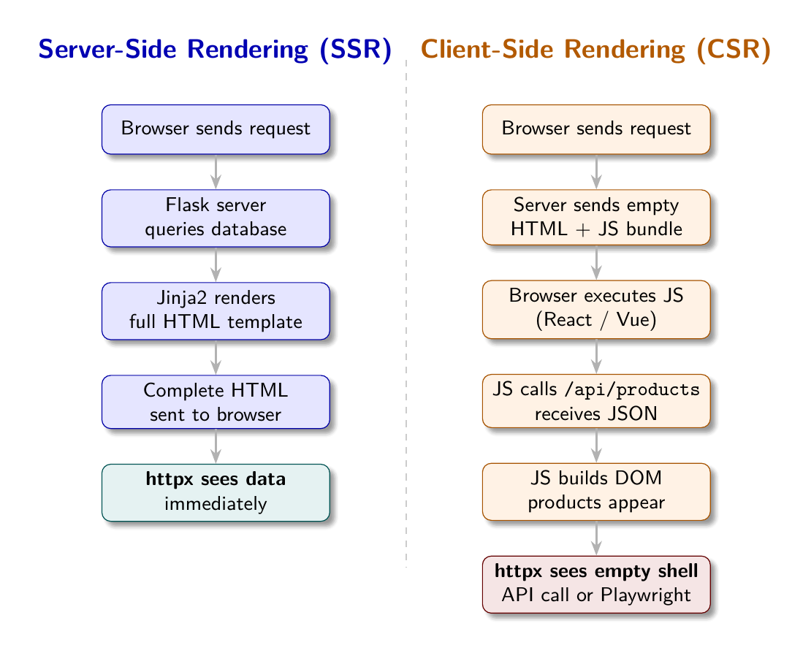

# Chapter 2: The Rendering Landscape

Chapter 1 established what scraping is and why it exists. Before you can extract data from a page, you need to understand how that page was built. Two pages can look identical in a browser but require completely different scraping approaches. The difference comes down to where and when the HTML was assembled.



## Two Paths to the Same Page

A user visits `https://shopsphere.example.com/products`. Their browser receives a response. The page renders. Products appear.

What happened between request and render? One of two things:

**Path A - Server-Side Rendering (SSR):** The server received the request, queried its database, built an HTML document containing the product data, and sent that document to the browser. The browser displayed what it received. The data is in the HTML.

**Path B - Client-Side Rendering (CSR):** The server received the request and sent back a minimal HTML document: a `<head>`, a `<body>` with an empty `<div id="app">`, and a `<script>` tag pointing to a JavaScript bundle. The browser executed that JavaScript. The JavaScript made API calls to fetch product data. The JavaScript inserted product HTML into the DOM. The page appeared to the user.

In both cases the user sees products. To the scraper, these are completely different situations.

## The SSR World

In an SSR response, the HTML contains the data:

```html
<!-- Simplified SSR response -->
<article class="product-card" data-product-id="PROD-001">
  <h2><a href="/products/macbook-pro-14">MacBook Pro 14"</a></h2>
  <span class="product-price">$1,999.00</span>
  <span class="product-rating" data-rating="4.8">4.8/5</span>
</article>
```

`curl`, `httpx.get()`, `requests.get()`: any HTTP client fetching this URL receives this HTML. `BeautifulSoup` can parse it immediately. The data is there.

SSR is the traditional architecture of the web. It is used by sites that prioritize initial page load speed, SEO (search engines struggle with CSR), and compatibility with clients that cannot run JavaScript. Many government sites, news sites, traditional e-commerce platforms, and content sites use SSR.

## The CSR World

In a CSR response, the HTML is a shell:

```html
<!-- CSR response - what the server actually sends -->
<!DOCTYPE html>
<html>
<head><title>ShopSphere</title></head>
<body>
  <div id="app">
    <div class="loading">Loading products...</div>
  </div>
  <script src="/app.bundle.js"></script>
</body>
</html>
```

`curl` fetches this. `BeautifulSoup` parses it. You get "Loading products..." and nothing else. The products exist only after the JavaScript executes and makes API calls, which a static HTTP client does not do.

CSR grew out of the rise of JavaScript frameworks: React, Vue, Angular, Svelte. These frameworks make it easy to build complex, interactive user interfaces where the browser is responsible for rendering. They are popular because they create smooth, app-like user experiences.

The scraping consequence: the real data is not in the HTML. It is in the API responses that the JavaScript makes. You can either:
1. Find and call those APIs directly (reverse-engineer the JSON API)
2. Use a headless browser that runs the JavaScript (Playwright)

## A Third Category: Server-Side Generation

Some sites use static site generation (SSG): pages are pre-built at deploy time and served as static files. Jekyll, Hugo, Next.js in static mode. These look like SSR to a scraper: full HTML content in the response. No JavaScript needed.

Some sites use hybrid rendering: the initial page is SSR (for speed and SEO), but subsequent interactions are CSR (for interactivity). A product listing page might be SSR; filtering by category might trigger a CSR re-render without a full page reload.

For scraping purposes, what matters is what you receive in the first HTTP response. Hybrid sites that render their listing and detail pages server-side are effectively SSR for your purposes, even if they have interactive components.

## Detecting the Rendering Mode

Before writing a single selector, probe the page to determine its rendering mode. The signal is straightforward: how much visible text is in the raw HTTP response?

```python
import httpx
from bs4 import BeautifulSoup

def detect_render_mode(url: str, probe_selector: str = None) -> str:
    resp = httpx.get(url, headers={"User-Agent": "Mozilla/5.0"})
    soup = BeautifulSoup(resp.text, "lxml")
    visible_text = soup.get_text(strip=True)

    # Signal 1: very little text means the page is a JavaScript shell
    if len(visible_text) < 300:
        return "playwright"

    # Signal 2: a content selector that should match something returns nothing
    if probe_selector and not soup.select(probe_selector):
        return "playwright"

    return "static"
```

The visible text threshold of 300 characters is a practical heuristic. A real content page has thousands of characters of visible text. A JavaScript shell might have 50: the loading message, maybe the site name in the header.

The probe selector is stronger: if you know the selector for content elements (`.product-card`, `.job-listing`), and it matches nothing on a page that should have dozens of such elements, that is definitive evidence of CSR.

## The API Layer of CSR Sites

CSR sites expose their data through internal JSON APIs. The browser's JavaScript calls these APIs; so can you. Open your browser's DevTools, navigate to the Network tab, filter by XHR/Fetch, and watch the requests the page makes. You will see calls like:

```
GET /api/products?page=1&category=electronics
```

Response:
```json
{
  "products": [
    {"id": "PROD-001", "name": "MacBook Pro 14\"", "price": 1999.00, ...},
    ...
  ],
  "page": 1,
  "total_pages": 5
}
```

If you can call this API directly, you should. JSON is cleaner to parse than HTML. You get all the data fields, not just the ones rendered in the UI. You avoid the overhead of running a headless browser.

The catch: internal APIs are undocumented, may require authentication cookies or CSRF tokens, may have more aggressive rate limiting than the public site, and can change without notice. Direct API access is more fragile than HTML scraping, even though the data is cleaner.

## Playwright: The Headless Browser Solution

When direct API access is not viable, you need a browser that executes JavaScript. Playwright (from Microsoft) is the current standard for this. It drives Chromium, Firefox, or WebKit headlessly: no visible window, but full browser capabilities.

```python
from playwright.async_api import async_playwright

async def fetch_rendered_html(url: str) -> str:
    async with async_playwright() as p:
        browser = await p.chromium.launch(headless=True)
        page = await browser.new_page()
        # Wait until the page stops making network requests
        await page.goto(url, wait_until="networkidle")
        html = await page.content()  # Full rendered DOM
        await browser.close()
    return html
```

After `page.content()`, the HTML contains everything a user would see: products rendered from API responses, dynamic elements, lazy-loaded content. `BeautifulSoup` can now parse this HTML normally.

The cost: Playwright launches a full browser process. It is slower (3-10 seconds per page vs under 1 second for `httpx`), heavier (hundreds of MB of memory for a browser instance), and more complex to operate. Chapter 8 covers Playwright in depth, including pooling, resource blocking, and performance optimization.

## The Auto-Fallback Pattern

The most practical approach for scrapers that need to handle both SSR and CSR sites:

```python
async def fetch_with_fallback(url: str, probe_selector: str) -> tuple[str, str]:
    # Step 1: Try static fetch
    html = httpx.get(url).text
    soup = BeautifulSoup(html, "lxml")

    # Step 2: Probe for content
    if soup.select(probe_selector):
        return html, "static"  # Content found, no JS needed

    # Step 3: Escalate to Playwright
    html = await fetch_rendered_html(url)
    return html, "playwright"
```

This pattern:
- Uses fast static fetching for SSR sites (the majority of the web)
- Automatically detects when CSR escalation is needed
- Falls back transparently without manual configuration

The bylgja scraper engine implements this as `render_mode: auto`. It tries static, checks whether the first field selector matches anything, and escalates to Playwright if not. Chapters 7, 8, and 9 build this in full detail.

## Why Rendering Mode Matters for Configuration

The `render_mode` field in a scraper config is not a hint; it is a fundamental instruction. Setting it correctly is the first decision in config authoring:

| `render_mode` | When to use |
|---------------|-------------|
| `static` | SSR sites, static sites, direct API endpoints |
| `playwright` | CSR sites where API reverse-engineering is not viable |
| `auto` | When unsure; probe first, escalate if needed |

For the four demo sites in this book:
- ShopSphere SSR (`localhost:8001`): `render_mode: static`
- ShopSphere CSR (`localhost:8002`): `render_mode: playwright`
- JobHive SSR (`localhost:8003`): `render_mode: static`
- JobHive CSR (`localhost:8004`): `render_mode: playwright`

The CSS selectors are identical across SSR and CSR versions of the same site. The data appears in the same DOM structure either way. The only difference is whether Playwright had to run first to build that DOM.

## Real-World Rendering Distribution

Based on crawl data from major web indices, the distribution of rendering approaches on the modern web is roughly:

- Traditional SSR (PHP, Ruby on Rails, Django templates, Jinja2): ~45%
- Static site generation (Jekyll, Hugo, Gatsby): ~20%
- Hybrid (Next.js, Nuxt.js with server rendering): ~20%
- Full CSR (single-page applications, React/Vue without SSR): ~15%

The implication: static fetching works for roughly 85% of the web. Playwright is needed for the remaining 15%, which is a meaningful minority. For well-resourced commercial sites (e-commerce, job boards, SaaS products), the CSR percentage is higher, perhaps 40%. These sites invest in modern JavaScript frameworks for their user experience. They are also the most commercially valuable scraping targets.

## Apply This

**1. Always probe before scraping.** Fetch the first page, measure visible text length, and check whether your expected selectors match. This 0.1 second investment saves hours of debugging why your selectors return nothing.

**2. Check the Network tab before reaching for Playwright.** Open DevTools on a CSR site. If there is a clean JSON API, call it directly. Clean JSON beats HTML parsing every time. Pitfall: APIs often require auth tokens sent as cookies or headers from a previous page load.

**3. Treat `render_mode: auto` as your default during development.** Let the probe detect the rendering mode. Lock it to `static` or `playwright` in production once you know which applies.

**4. Version-pin your rendering dependencies.** Playwright versions and browser binaries need to stay in sync. Pin both in your requirements file. A Playwright update that changes wait-until behavior can silently break scrapers.

**5. Document why you chose a rendering mode.** In your config, include a description field explaining whether the site is SSR or CSR and why. Six months later, when a site migrates from SSR to React, the history of that decision matters.
