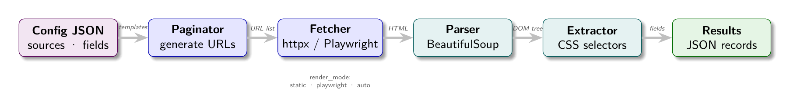

# Chapter 3: The JSON Config Contract

Chapters 1 and 2 established the problem: web data is locked behind HTML, and that HTML arrives in two fundamentally different forms depending on whether JavaScript rendered it. This chapter introduces the solution architecture: a JSON-based configuration format that expresses a complete scraping specification in a form both humans and machines can reason about.



## Why Not Just Write Code?

The obvious approach to scraping is to write Python (or JavaScript, or Go) directly. Fetch a URL, parse the HTML, extract the fields, save to a database. For a one-off script, this is fine. For a production scraping system serving dozens of targets, it breaks down.

**The proliferation problem.** Ten different scraping targets means ten different scripts. Fixing a bug in your retry logic means touching ten files. Adding a new field means modifying the correct script out of ten. The code surface grows linearly with targets.

**The operational problem.** Scraping configurations change. Sites redesign. Selectors break. Someone needs to update the config at 2am when the morning data pipeline fails. The person on call may not be the person who wrote the Python. A JSON file is more accessible than a Python class hierarchy.

**The AI problem.** Language models can generate JSON. They can generate Python too, but untrusted Python is a security risk: it can call `os.system()`, read files, open network connections. Untrusted JSON with a defined schema is safe. If you want an AI agent to generate your scraping configurations, JSON is the right format.

**The auditability problem.** A JSON config is a declaration of intent. "Extract the `h1.product-title` as the `title` field." This is readable by non-engineers: product managers, data analysts, the ops team member on call. Code that does the same thing is not.

The JSON config approach makes a deliberate trade: you give up the full expressiveness of a programming language and gain portability, auditability, and machine-generability.

## The Config Schema

A bylgja-format scraper config has four top-level sections:

```json
{
  "name": "ShopSphere SSR",
  "description": "Marketplace - server-side rendered, static fetch works",
  "render_mode": "static",
  "sources": [...],
  "listing": {...},
  "fields": {...}
}
```

Each section solves a specific part of the scraping problem.

### Sources: Where to Fetch

The `sources` array tells the engine how to generate the list of listing page URLs. Each source has a URL template with a `{n}` placeholder that the pagination engine replaces:

```json
"sources": [
  {
    "url_template": "https://jobs.example.com/listings?page={n}",
    "index_type": "page",
    "pagination": {
      "start": 1,
      "step": 1,
      "max_pages": 50,
      "stop_condition": "no_results"
    }
  }
]
```

The `{n}` is replaced with `start`, `start + step`, `start + 2*step`, and so on, up to `max_pages` URLs. The engine stops early when the stop condition triggers (no links found, a sentinel text appears, an HTTP error).

Multiple sources are supported for sites that organize their content across multiple root URLs:

```json
"sources": [
  {
    "url_template": "https://jobs.example.com/engineering?page={n}",
    "pagination": {"start": 1, "step": 1, "max_pages": 20, "stop_condition": "no_results"},
    "meta": {"department": "Engineering"}
  },
  {
    "url_template": "https://jobs.example.com/design?page={n}",
    "pagination": {"start": 1, "step": 1, "max_pages": 10, "stop_condition": "no_results"},
    "meta": {"department": "Design"}
  }
]
```

The `meta` object is injected into every record scraped from that source. It adds context that is not on the page itself: the department, the region, the data category.

### Listing: How to Find Detail Links

The `listing` section describes how to extract item URLs from each listing page. The engine applies the `link_selector` to find anchor elements, then follows each href to a detail page:

```json
"listing": {
  "link_selector": "a.job-link",
  "link_prefix": "https://jobs.example.com"
}
```

The `link_prefix` handles relative hrefs. If the page has `<a href="/jobs/senior-engineer">`, the engine prepends the prefix to get `https://jobs.example.com/jobs/senior-engineer`.

### Fields: What to Extract

The `fields` object is the extraction specification. Each key is a field name; each value is a field config describing how to extract it:

```json
"fields": {
  "title": {
    "selector": "h1.job-detail-title",
    "retrieve": "plaintext"
  },
  "salary_min": {
    "selector": "span.salary-range",
    "retrieve": "regexp",
    "pattern": "\\$(\\d[\\d,]+)"
  },
  "location": {
    "selector": "span.job-location",
    "retrieve": "plaintext"
  },
  "requirements": {
    "selector": "li.requirement-item",
    "retrieve": "plaintext",
    "multiple": true
  },
  "job_id": {
    "selector": "div.job-detail",
    "retrieve": "attr",
    "attr": "data-job-id"
  }
}
```

The `retrieve` field specifies the extraction method:

| `retrieve` value | What it extracts |
|-----------------|------------------|
| `plaintext` | `element.get_text(strip=True)` |
| `attr` | `element.get(attr_name)` |
| `regexp` | Regex match on the text content |
| `regexpall` | All regex matches, returns a list |

Setting `"multiple": true` returns a list of values from all matching elements, not just the first.

### Temp Fields and Computed Fields

Fields prefixed with `_` are temporary: extracted for use in computing other fields, but not included in the final record. This solves the common problem of needing to extract an intermediate value to derive a final one.

Computed fields use `stage`: a sandboxed Python snippet that receives the current field values and returns a new value:

```json
"fields": {
  "_raw_salary": {
    "selector": "span.salary",
    "retrieve": "plaintext"
  },
  "salary_usd": {
    "selector": "span.salary",
    "retrieve": "plaintext",
    "stage": "return value.replace('$', '').replace(',', '') if value else None",
    "deps": ["_raw_salary"]
  }
}
```

The `deps` array tells the engine to extract `_raw_salary` first and make it available to the `salary_usd` stage function.

## The Batch Fields Pattern

Many detail pages present specifications in a key-value table:

```html
<table class="specs-table">
  <tr><td class="spec-key">Processor</td><td class="spec-value">Apple M3 Pro</td></tr>
  <tr><td class="spec-key">RAM</td><td class="spec-value">18GB</td></tr>
  <tr><td class="spec-key">Storage</td><td class="spec-value">512GB SSD</td></tr>
</table>
```

Writing a separate field config for each spec row is tedious. The `batch_fields` config handles this with a single declaration:

```json
"batch_fields": {
  "selector": "table.specs-table tr",
  "key_selector": "td.spec-key",
  "value_selector": "td.spec-value",
  "mapping": {
    "Processor": "spec_processor",
    "RAM": "spec_ram",
    "Storage": "spec_storage"
  }
}
```

The engine iterates rows, extracts key and value from each, and maps the key text to a field name via the `mapping` object. Unmapped rows are discarded. This pattern handles electronics specs, job requirement tables, property attribute lists, and any other structured key-value content.

## A Complete Config Example

Here is a full config for the JobHive SSR demo site:

```json
{
  "name": "JobHive SSR",
  "description": "Server-side rendered job board. Static fetch works directly.",
  "render_mode": "static",
  "request": {
    "headers": {
      "User-Agent": "Mozilla/5.0 (compatible; Scraper/1.0)"
    }
  },
  "sources": [
    {
      "url_template": "http://localhost:8003/jobs?page={n}",
      "pagination": {
        "start": 1,
        "step": 1,
        "max_pages": 10,
        "stop_condition": "no_results"
      }
    }
  ],
  "listing": {
    "link_selector": "a.job-link",
    "link_prefix": "http://localhost:8003"
  },
  "fields": {
    "title":       {"selector": "h1.job-detail-title",   "retrieve": "plaintext"},
    "company":     {"selector": "div.job-detail-company","retrieve": "plaintext"},
    "location":    {"selector": "span.job-location",     "retrieve": "plaintext"},
    "salary_min":  {"selector": "span.salary-range",     "retrieve": "regexp", "pattern": "\\$(\\d[\\d,]+)"},
    "salary_max":  {"selector": "span.salary-range",     "retrieve": "regexp", "pattern": "\\$[\\d,]+ - \\$(\\d[\\d,]+)"},
    "remote_type": {"selector": "span.badge-remote",     "retrieve": "plaintext"},
    "job_type":    {"selector": "span.badge-type",       "retrieve": "plaintext"},
    "description": {"selector": "p.job-description-full","retrieve": "plaintext"},
    "job_id":      {"selector": "div.job-detail",        "retrieve": "attr", "attr": "data-job-id"},
    "requirements":{"selector": "li.requirement-item",   "retrieve": "plaintext", "multiple": true},
    "benefits":    {"selector": "li.benefit-item",       "retrieve": "plaintext", "multiple": true}
  }
}
```

This 40-line JSON file completely specifies a production scraper for a job board. Read it in isolation and you know: which URLs to crawl, how many pages, which links to follow, and what to extract from each job detail page.

## The Contract Metaphor

The word "contract" in this chapter's title is intentional. A scraper config is a contract between three parties:

**The site** provides HTML with a predictable structure. As long as the selectors in the config match elements on the page, the contract holds.

**The engine** commits to executing the config faithfully: generating the right URLs, following the right links, applying each field's selector and retrieve method, storing the results.

**The operator** (human or AI) defines the config correctly: valid selectors that match the right elements, correct retrieve methods, sensible pagination parameters.

When the contract breaks, the cause is usually one of:
1. The site changed its HTML structure (selector no longer matches)
2. The engine has a bug (a retrieve method behaves unexpectedly)
3. The operator wrote an incorrect config (wrong selector, typo in field name)

This three-party framing makes debugging systematic. Start by verifying the site structure. Then verify the engine behavior. Then verify the config.

## Config as AI Instruction Set

The most powerful property of the JSON config is that it is a complete, unambiguous specification of a scraping task. Given a URL and a field list, an LLM can generate a config. Given a config and error feedback, an LLM can fix it. Given a config and scraped data, an LLM can validate whether the extraction looks correct.

This is explored in depth in Part 5, but the foundational observation belongs here: **the JSON config is a language that AI can speak**. It is not a prompt or a natural language description; it is a structured specification with a defined schema. An LLM generating a config is doing structured output generation, which is a well-solved problem for modern language models.

The alternative, where an LLM generates Python scraping code, has serious problems: the code may be syntactically valid but logically wrong; it may import dangerous libraries; it may have security vulnerabilities; it cannot be safely executed without review. JSON with a defined schema can be validated structurally before execution and reviewed by non-engineers.

## Apply This

**1. Start with the schema, not the selectors.** Before opening DevTools to inspect a page, define your output record schema. What fields does your downstream system need? What are their types? What makes a record valid? The schema defines your field list; the field list defines what you need to find selectors for.

**2. Name fields for the data, not the HTML.** Call it `salary_min`, not `salary_range_left_side`. The field name is part of the API you expose to downstream consumers. Make it self-documenting.

**3. Use `multiple: true` conservatively.** Multiple-value fields produce arrays. Most downstream systems prefer scalar values. Only use `multiple` when the field is genuinely multi-valued (requirements list, tags list) and when your pipeline handles arrays.

**4. Test batch_fields separately.** Key-value tables are fragile. Site redesigns often change table structure while keeping content. Write a quick test that fetches one page and prints the batch_fields output before adding it to production configs.

**5. Version your configs.** Commit every config change to version control with a message explaining what changed and why. When a site redesigns and your selectors break, git blame tells you what you had before. This history is invaluable for debugging and for training AI models to understand what kinds of HTML changes break which selectors.
