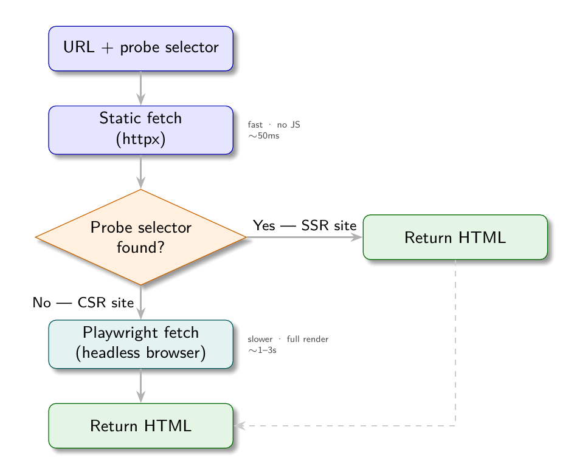

# Chapter 9: The Auto-Fallback Engine

Static fetching is fast and cheap. Playwright is slower and resource-intensive. In an ideal world, you know in advance which approach each site requires and set `render_mode` accordingly. In practice, you often do not know until you try - and sometimes a site switches from SSR to CSR, or uses a hybrid approach where some pages are static and others are dynamic.

The `auto` render mode solves this: try static first, probe for content, escalate to Playwright only when necessary. This chapter explains how the fallback engine works and when to use it.

## The Problem with Manual Mode Selection

Manual render mode selection has two failure modes:

**Over-specifying `playwright`**: Using Playwright for a site that returns full HTML statically. Result: correct data, but 5-10x slower than necessary and consuming browser resources.

**Under-specifying `static`**: Using static fetching for a CSR site. Result: the scraper runs without errors but extracts no data, because the probe selector finds nothing in the HTML shell.

The second failure is the more dangerous one. A scraper that completes successfully but returns empty results can go undetected until someone notices the data is missing.

## The Auto-Fallback Algorithm



```
1. Fetch the URL with httpx (static)
2. Probe the fetched HTML for a known element (the probe selector)
3. If the probe element is found:
   → Static HTML contains content; continue with static fetch
4. If the probe element is not found:
   → Page is likely CSR; switch to Playwright
   → Fetch the same URL with Playwright
   → Extract content from the fully rendered HTML
```

In code:

```python
async def fetch_auto(url: str, probe_selector: str) -> str:
    # Attempt static fetch
    html = await fetch_static(url)
    soup = BeautifulSoup(html, "lxml")

    # Probe for expected content
    if soup.select_one(probe_selector):
        return html  # Static HTML has the content; use it

    # Probe failed: escalate to Playwright
    return await fetch_playwright(url)
```

The probe selector is the key: it must be an element that is definitely present after rendering but definitely absent in the pre-JavaScript HTML shell of a CSR site. The product card selector (`.product-card`) and job card selector (`.job-card`) are good probes - they are the content elements, not navigation or layout elements that might be present in both SSR and CSR versions.

## Configuring the Probe Selector

The probe selector is specified in the config's `listing` section:

```json
{
  "render_mode": "auto",
  "sources": [...],
  "listing": {
    "link_selector": ".product-card a.product-link",
    "probe_selector": ".product-card"
  },
  "fields": {...}
}
```

If `probe_selector` is not specified, the engine falls back to a text length heuristic: if the static HTML contains fewer than 200 characters of visible text, assume it is a CSR shell and escalate.

The heuristic works for obvious cases (truly empty shells) but can fail for pages with substantial navigation text but no content. An explicit probe selector is more reliable.

## Per-Page vs. Per-Site Fallback

The auto-fallback engine applies the probe at the listing page level. Once it determines that a site uses Playwright, it uses Playwright for all subsequent pages in that scrape run.

For detail pages, the engine assumes the same render mode as the listing page. This is almost always correct: a site does not usually use SSR for listing pages and CSR for detail pages, or vice versa.

If you encounter a site with mixed rendering (SSR listing, CSR detail), use `render_mode: "playwright"` for the whole config. The cost of using Playwright on an SSR page is minimal - it fetches the HTML and returns the same content, just slower.

## Caching the Mode Decision

In a production system, re-probing on every scrape run wastes time and resources. Once you have determined that a site uses Playwright, cache that determination:

```python
# Simple in-memory cache per scrape session
render_mode_cache = {}

async def fetch_with_cache(url: str, config: dict) -> str:
    host = urlparse(url).netloc

    if host not in render_mode_cache:
        # First request: probe
        html = await fetch_auto(url, config["listing"].get("probe_selector"))
        render_mode_cache[host] = "playwright" if used_playwright else "static"
        return html

    # Subsequent requests: use cached decision
    if render_mode_cache[host] == "playwright":
        return await fetch_playwright(url)
    else:
        return await fetch_static(url)
```

This only applies when `render_mode` is `"auto"`. If explicitly set to `"static"` or `"playwright"`, no probing is needed.

## The Demo Sites as a Test Case

The four demo sites make the auto-fallback concrete. ShopSphere SSR (port 8001) and ShopSphere CSR (port 8002) have identical content and identical rendered DOM structure. The only difference is how the DOM is produced.

Running a config with `render_mode: "auto"` against both:

```python
config_auto = {
    "render_mode": "auto",
    "sources": [{"url_template": "http://localhost:{port}/products?page={n}",
                 "pagination": {"start": 1, "step": 1, "max_pages": 10, "stop_condition": "no_results"}}],
    "listing": {
        "link_selector": ".product-card a.product-link",
        "probe_selector": ".product-card"
    },
    "fields": {
        "title": {"selector": "h1.product-title", "retrieve": "plaintext"},
        "price": {"selector": "span.price-amount", "retrieve": "plaintext"},
    }
}

# Against SSR (port 8001): static fetch succeeds, returns 10 products per page
# Against CSR (port 8002): static probe finds no .product-card, Playwright is used
```

The output is identical either way. This is the point: the auto-fallback engine makes `render_mode` an implementation detail, not a config author concern. For sites you are confident about, set it explicitly. For unknown sites or the AI config generator, use `auto`.

## When Auto-Fallback Is Not Appropriate

The `auto` mode has a cost: every listing page requires an initial static fetch before Playwright is considered. For sites you know require Playwright, this adds latency.

For production configs where the render mode is established, use the explicit mode. The `auto` mode is most valuable for:

- Initial exploration of unknown sites
- AI-generated configs where the render mode cannot be determined without inspection
- Sites that might change their rendering approach (a migration from SSR to CSR is common)
- Books and demos that want to show resilience to rendering changes

## The Full Engine

With all three chapters of Part 3 assembled, the complete fetch layer looks like:

```python
async def fetch(url: str, render_mode: str, probe_selector: str = None) -> str:
    if render_mode == "static":
        return await fetch_static(url)

    elif render_mode == "playwright":
        return await fetch_playwright(url)

    elif render_mode == "auto":
        # Try static first
        html = await fetch_static(url)
        soup = BeautifulSoup(html, "lxml")

        # Check probe or text length
        if probe_selector:
            if soup.select_one(probe_selector):
                return html
        else:
            if len(soup.get_text(strip=True)) >= 200:
                return html

        # Escalate to Playwright
        return await fetch_playwright(url)

    else:
        raise ValueError(f"Unknown render_mode: {render_mode!r}")
```

This function is the entry point for the entire extraction pipeline. Everything downstream - pagination, field extraction, storage - is agnostic to which path was taken. The HTML comes in, the data comes out.

## Apply This

**1. Use `auto` during development, switch to explicit for production.** During development, `auto` probes each page and tells you which mode was selected. Once you have confirmed the mode, set it explicitly in the config to remove the overhead.

**2. Make the probe selector specific to content, not chrome.** Navigation bars, footers, and sidebars often contain the same elements in both SSR and CSR shells. Probe for product cards, job listings, or other content-specific elements that are only present after JavaScript rendering.

**3. Log which mode was chosen.** When `render_mode: "auto"`, log whether static or Playwright was used for each page. This provides visibility into when sites change their rendering approach.

**4. Consider the cost of false static.** If your probe selector is too generic and matches a navigation element present in the CSR shell, the auto-fallback will incorrectly choose static mode and extract no content. Test the probe selector against the CSR version's raw HTML specifically.

**5. The `auto` mode is good for AI-generated configs.** When an LLM generates a config from a URL, it cannot always determine whether the site is SSR or CSR from the HTML summary alone. Setting `render_mode: "auto"` in AI-generated configs is a safe default that will work correctly regardless.
