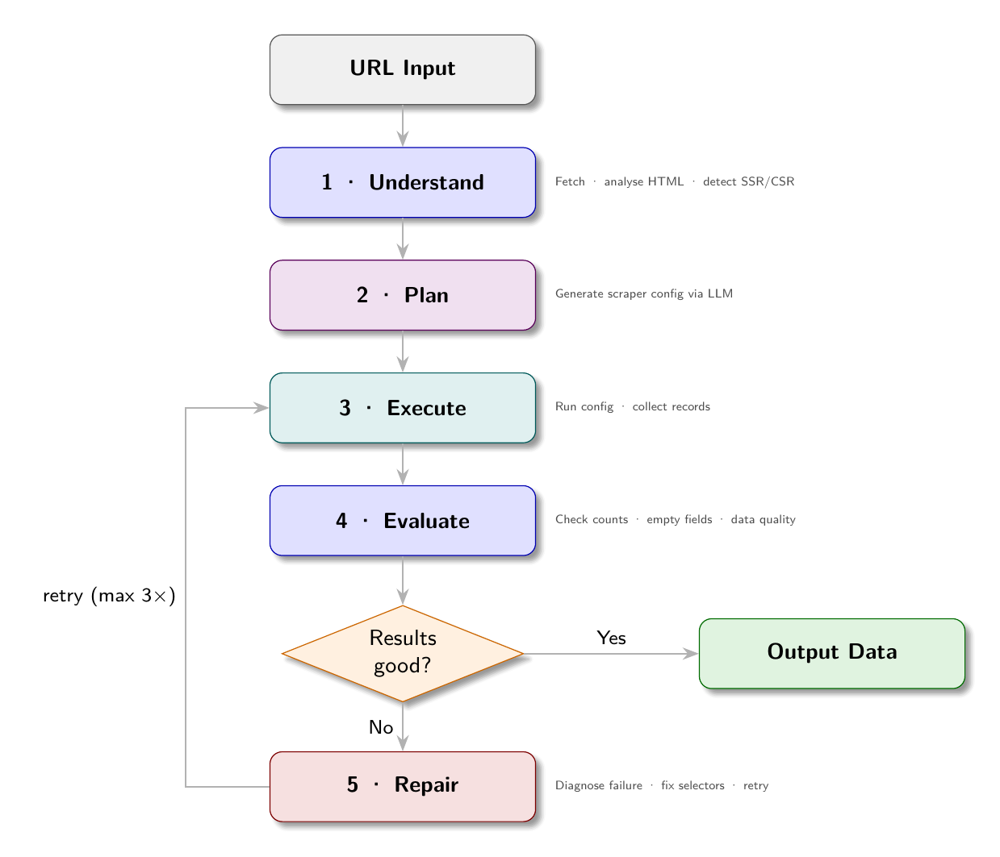

# Chapter 14: Autonomous Scraping Agents

Chapter 13 showed how AI can generate scraper configs from HTML structure. This chapter covers the full autonomous loop: an agent that takes a URL as input and produces clean, structured data as output, with no human involvement in between.

The agent does not just run a scraper. It plans, executes, evaluates, and repairs. When the first config it generates does not work, it examines the failure, generates a corrected config, and tries again. When the data looks wrong, it flags the issue and explains why.

## The Autonomous Loop

The autonomous scraping agent operates as a reasoning loop:



```
Input: URL to scrape
  |
  v
Stage 1: UNDERSTAND
  Fetch the page. Analyze its structure.
  Is it SSR or CSR? What type of site is this?
  What fields can be extracted?
  |
  v
Stage 2: PLAN
  Generate a scraper config from the structure analysis.
  Select render mode, link selectors, field selectors.
  |
  v
Stage 3: EXECUTE
  Run the config against the site.
  Collect results.
  |
  v
Stage 4: EVALUATE
  Are the results good? Any empty fields? Wrong counts?
  Does the data look correct for this type of site?
  |
  v
Decision:
  Results good? -> Output data
  Results bad?  -> Stage 5
  |
  v
Stage 5: REPAIR
  Identify what went wrong.
  Generate a corrected config.
  Go back to Stage 3 (up to N times)
```

This loop is the difference between a config generator (Chapter 13) and an autonomous agent (this chapter). The generator produces a config and stops. The agent validates the output and iterates until quality is achieved.

## Implementing the Agent

The agent in `agents/autonomous_scraper.py` implements this loop:

```python
import asyncio
import json
import httpx
from bs4 import BeautifulSoup
from agents.llm import chat
from agents.config_generator import summarise_html, generate_config

async def run_autonomous(
    url: str,
    max_items: int = 20,
    max_repair_attempts: int = 3,
) -> dict:
    """
    Autonomous scraping agent. Takes a URL and returns structured data.
    """
    print(f"[agent] Starting autonomous scrape of {url}")

    # Stage 1: Understand
    print("[agent] Fetching and analyzing page structure...")
    async with httpx.AsyncClient(
        headers={"User-Agent": "Mozilla/5.0"},
        timeout=30
    ) as client:
        resp = await client.get(url)
        html = resp.text

    summary = summarise_html(html)
    is_csr = len(BeautifulSoup(html, "lxml").get_text(strip=True)) < 200

    if is_csr:
        print("[agent] Page appears to be CSR - will use Playwright")

    # Stage 2: Plan
    print("[agent] Generating scraper config...")
    config = await generate_config(url, html_summary=summary, is_csr=is_csr)
    print(f"[agent] Generated config with {len(config.get('fields', {}))} fields")

    # Stage 3 + 4 + 5: Execute, evaluate, repair loop
    for attempt in range(max_repair_attempts + 1):
        print(f"[agent] Executing config (attempt {attempt + 1})...")
        results = await execute_config(config, max_items=max_items)

        evaluation = evaluate_results(results, config)

        if evaluation["pass"]:
            print(f"[agent] Extraction successful: {len(results)} items")
            break

        if attempt < max_repair_attempts:
            print(f"[agent] Evaluation failed: {evaluation['reason']}")
            print(f"[agent] Attempting repair...")
            config = await repair_config(config, url, html, evaluation["reason"])
        else:
            print(f"[agent] Max repair attempts reached, returning best-effort results")

    return {
        "url": url,
        "config": config,
        "results": results,
        "item_count": len(results),
        "evaluation": evaluation,
    }
```

## The Evaluation Function

The evaluator checks the results against quality criteria:

```python
def evaluate_results(results: list[dict], config: dict) -> dict:
    if not results:
        return {
            "pass": False,
            "reason": "No items were extracted. The link_selector may be wrong, "
                      "or the site may require a different render_mode."
        }

    # Check required fields are populated
    fields = config.get("fields", {})
    required_fields = [k for k, v in fields.items() if not k.startswith("_")]

    empty_field_rates = {}
    for field in required_fields:
        empty_count = sum(1 for r in results if not r.get(field))
        if empty_count > 0:
            rate = empty_count / len(results)
            if rate > 0.3:  # > 30% empty is suspicious
                empty_field_rates[field] = rate

    if empty_field_rates:
        worst = max(empty_field_rates, key=lambda k: empty_field_rates[k])
        rate = empty_field_rates[worst]
        return {
            "pass": False,
            "reason": (
                f"Field '{worst}' is empty in {rate*100:.0f}% of records "
                f"({int(rate * len(results))}/{len(results)}). "
                f"The selector may be wrong or the field may not exist on all detail pages."
            )
        }

    # Sample check: ask LLM if the data looks correct
    sample = results[:3]
    verdict = llm_validate_sample(sample, config)
    if not verdict["ok"]:
        return {"pass": False, "reason": verdict["reason"]}

    return {"pass": True, "reason": "All checks passed"}
```

## LLM Validation of Sample Data

The LLM can evaluate whether scraped data looks correct for its context:

```python
def llm_validate_sample(sample: list[dict], config: dict) -> dict:
    prompt = f"""You are evaluating the quality of scraped data.

Here are {len(sample)} sample records extracted from a web scraper:

{json.dumps(sample, indent=2)}

Evaluate whether this data looks correct and complete for what appears to be a 
{detect_site_type(config)} website. 

Check for:
- Are field values plausible for this type of site?
- Are any fields that should be populated showing None or empty values?
- Are the values in reasonable formats (prices look like prices, dates look like dates)?

Respond with JSON: {{"ok": true/false, "reason": "brief explanation"}}
Only respond with the JSON, no other text."""

    response = chat([{"role": "user", "content": prompt}], temperature=0.1)

    try:
        return json.loads(response)
    except json.JSONDecodeError:
        return {"ok": True, "reason": "Could not parse LLM response; assuming ok"}

def detect_site_type(config: dict) -> str:
    fields = set(config.get("fields", {}).keys())
    if any(f in fields for f in ["salary", "company", "job_type", "department"]):
        return "job board"
    elif any(f in fields for f in ["price", "rating", "in_stock", "category"]):
        return "product marketplace"
    else:
        return "content"
```

## The Repair Step

When evaluation fails, the agent asks the LLM to repair the config:

```python
async def repair_config(
    config: dict,
    url: str,
    html: str,
    error: str
) -> dict:
    summary = summarise_html(html)

    prompt = f"""You previously generated this scraper config for {url}:

{json.dumps(config, indent=2)}

The scraper ran but had this problem:
{error}

Here is the HTML structure of the page:
{summary}

Generate a corrected config that fixes the problem. 
Output ONLY valid JSON with no explanation."""

    response = chat([{"role": "user", "content": prompt}], temperature=0.2)

    # Extract JSON from response
    try:
        # Try direct parse first
        return json.loads(response)
    except json.JSONDecodeError:
        # Find JSON block in response
        import re
        match = re.search(r'\{[\s\S]*\}', response)
        if match:
            return json.loads(match.group())
        return config  # Return original if repair fails
```

The repair prompt includes the original config, the specific error message, and the HTML structure. With this context, the LLM can identify what needs to change.

## The Two-Pass Scraping Pattern

The autonomous agent uses a two-pass pattern for sites with listing pages:

**Pass 1: Collect links.** Fetch listing pages, extract links to detail pages. Do not extract data fields yet.

**Pass 2: Extract fields.** Fetch each detail page, extract all configured fields.

```python
async def execute_config(config: dict, max_items: int = 20) -> list[dict]:
    render_mode = config.get("render_mode", "static")
    listing = config.get("listing", {})
    fields = config.get("fields", {})

    # Pass 1: Collect links
    all_links = []
    for source in config.get("sources", []):
        links = await collect_links(source, listing, render_mode)
        all_links.extend(links)
        if len(all_links) >= max_items:
            break

    all_links = all_links[:max_items]
    print(f"[agent] Collected {len(all_links)} detail page links")

    # Pass 2: Extract fields
    semaphore = asyncio.Semaphore(4)
    results = []

    async def extract_one(link_url):
        async with semaphore:
            html = await fetch_page(link_url, render_mode)
            soup = BeautifulSoup(html, "lxml")
            record = extract_fields(soup, fields)
            record["url"] = link_url
            return record

    tasks = [extract_one(url) for url in all_links]
    results = await asyncio.gather(*tasks)

    return [r for r in results if r]
```

## Memory: The Config Registry

An autonomous agent should not regenerate configs from scratch every time. Once a config works for a site, store it. On the next run, load the stored config and skip the generation step.

```python
import json
from pathlib import Path

REGISTRY_DIR = Path("configs/registry")
REGISTRY_DIR.mkdir(parents=True, exist_ok=True)

def load_config_for_url(url: str) -> dict | None:
    from urllib.parse import urlparse
    host = urlparse(url).netloc.replace(".", "_")
    config_path = REGISTRY_DIR / f"{host}.json"
    if config_path.exists():
        return json.loads(config_path.read_text())
    return None

def save_config_for_url(url: str, config: dict):
    from urllib.parse import urlparse
    host = urlparse(url).netloc.replace(".", "_")
    config_path = REGISTRY_DIR / f"{host}.json"
    config_path.write_text(json.dumps(config, indent=2))

async def run_with_memory(url: str, max_items: int = 20) -> dict:
    # Check registry first
    config = load_config_for_url(url)

    if config:
        print(f"[agent] Found existing config for {url}")
        results = await execute_config(config, max_items=max_items)
        evaluation = evaluate_results(results, config)

        if evaluation["pass"]:
            return {"url": url, "results": results, "source": "registry"}

        print(f"[agent] Existing config failed: {evaluation['reason']}")
        print(f"[agent] Generating new config...")

    # Generate a new config
    result = await run_autonomous(url, max_items=max_items)

    # Save if successful
    if result["evaluation"]["pass"]:
        save_config_for_url(url, result["config"])
        print(f"[agent] Config saved to registry")

    return result
```

The registry-first approach means the agent learns. The first time it visits a site, it generates and repairs until it has a working config. Every subsequent visit loads the working config directly. When a site changes and the stored config starts failing, the agent falls back to generation automatically.

## Observing the Agent

Running the demo agent against the ShopSphere SSR demo site:

```
$ python agents/autonomous_scraper.py --url http://localhost:8001 --max-items 5

[agent] Starting autonomous scrape of http://localhost:8001
[agent] Fetching and analyzing page structure...
[agent] Page appears to be SSR (plenty of text content)
[agent] Generating scraper config...
[agent] Generated config with 8 fields
[agent] Executing config (attempt 1)...
[agent] Collected 50 detail page links
[agent] Extracting 5 items...
[agent] Evaluation successful: 5 items

Results:
[
  {
    "title": "MacBook Pro 14\"",
    "price": "$1,999.00",
    "rating": "4.8",
    "category": "Laptops",
    "in_stock": "true",
    ...
  },
  ...
]
```

Against the CSR version (localhost:8002):

```
[agent] Page appears to be CSR - will use Playwright
[agent] Generating config with render_mode: "playwright"
[agent] Executing config (attempt 1)...
[agent] Collected 50 detail page links
[agent] Extracting 5 items...
[agent] Evaluation successful: 5 items
```

The agent handles both rendering modes autonomously. The data is the same; only the execution path differs.

## Apply This

**1. Validate before storing.** Never write results to storage without checking that extraction succeeded. An agent that stores empty records on every failed run corrupts the dataset.

**2. Use the registry.** Regenerating configs on every run is expensive in LLM tokens and time. Store working configs and reload them. Treat config generation as a one-time cost with amortized benefit.

**3. Keep the repair loop bounded.** Three repair attempts is usually sufficient. More attempts rarely improve results - if the LLM has not fixed the problem in three tries, the issue is likely structural (the site requires a different approach) rather than a config detail.

**4. Log every agent decision.** Which path did it take? Did it generate or load from registry? What repair was attempted? This log is invaluable when debugging agent failures.

**5. Separate the agent from the scraper.** The agent is reasoning infrastructure; the scraper is execution infrastructure. Keep them cleanly separated. The agent calls the scraper; the scraper does not know it is being called by an agent. This separation allows the scraper to be used directly (without the agent loop) and allows the agent to be upgraded independently.
