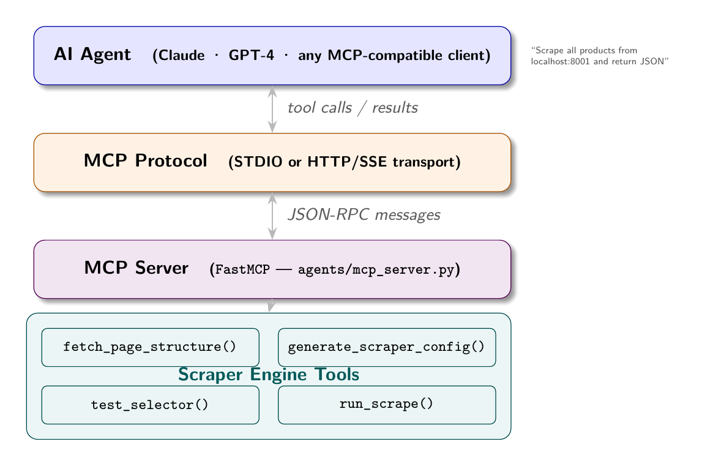

# Chapter 15: MCP and the Tool-First Paradigm

Chapter 13 established that AI agents can generate and repair scraper configs. Chapter 14 showed how autonomous agents run the full scraping loop. This chapter covers the infrastructure that makes scraping available to any AI agent: the Model Context Protocol (MCP).

## The Integration Problem

AI agents need tools. A language model by itself can reason, but it cannot fetch a URL, execute a CSS selector, or store data to a database. These capabilities are provided by tools: functions the model can call, receive results from, and incorporate into its reasoning.

The challenge is that every AI system has historically defined tools differently. OpenAI's function calling format, Anthropic's tool use format, Google's extensions - all different schemas, all requiring custom integration code. If you build a scraping tool for Claude, it does not work with GPT-4. If you build it for GPT-4, it does not work with the next model that arrives.

MCP (Model Context Protocol) is Anthropic's answer to this fragmentation. It defines a standard protocol for exposing tools, resources, and prompts to AI agents. An MCP server exposes capabilities; any MCP-compatible client (Claude Desktop, Claude Code, or any agent built on the MCP SDK) can use those capabilities without custom integration code.



## The Scraper as MCP Server

The bylgja scraper has exactly the right shape to become an MCP server. Its capabilities are already defined as discrete operations:

- Fetch and analyze a page's HTML structure
- Generate a scraper config from that structure
- Test a CSS selector against a URL
- Execute a scrape using a config
- Compare SSR and CSR rendering

Each of these is a natural MCP tool: a function with a defined input schema and a structured return value.

## The MCP Server Implementation

The `agents/mcp_server.py` file in this book's repository implements a scraper MCP server using the `mcp` Python library:

```python
from mcp.server.fastmcp import FastMCP

mcp = FastMCP("scraper")

@mcp.tool()
async def fetch_page_structure(url: str) -> str:
    """
    Fetch a URL and return a compact structural summary of its HTML.
    Use this to understand page layout before generating a scraper config.
    """
    resp = httpx.get(url, headers={"User-Agent": "Mozilla/5.0"})
    html = resp.text
    is_csr = len(BeautifulSoup(html, "lxml").get_text(strip=True)) < 200
    summary = summarise_html(html)
    return json.dumps({
        "url": url,
        "is_csr": is_csr,
        "structure": summary,
    })

@mcp.tool()
async def generate_scraper_config(url: str) -> str:
    """Generate a complete bylgja-format scraper config for a URL."""
    config = await generate_config(url)
    return json.dumps(config)

@mcp.tool()
async def test_selector(url: str, selector: str, render_mode: str = "static") -> str:
    """Test a CSS selector against a live URL."""
    html = await (fetch_playwright if render_mode == "playwright" else fetch_static)(url)
    soup = BeautifulSoup(html, "lxml")
    elements = soup.select(selector)
    return json.dumps({
        "count": len(elements),
        "previews": [el.get_text(strip=True)[:80] for el in elements[:5]],
    })

@mcp.tool()
async def run_scrape(config_json: str, max_items: int = 10) -> str:
    """Execute a scrape using a bylgja-format config JSON string."""
    config = json.loads(config_json)
    results = await run(config=config, max_items=max_items)
    return json.dumps({"count": len(results), "records": results})

if __name__ == "__main__":
    mcp.run()
```

The `@mcp.tool()` decorator registers each function as an MCP tool. The docstring becomes the tool description visible to the AI agent. The function signature defines the input parameters.

## Running the MCP Server

Start the server in STDIO mode (for Claude Desktop or Claude Code integration):

```bash
python agents/mcp_server.py
```

Or in HTTP mode for web-based agents:

```bash
mcp serve agents/mcp_server.py --port 8080
```

To connect from Claude Desktop, add to `claude_desktop_config.json`:

```json
{
  "mcpServers": {
    "scraper": {
      "command": "python",
      "args": ["/path/to/scrapping/agents/mcp_server.py"]
    }
  }
}
```

To connect from Claude Code (this CLI), add to `.claude/settings.json`:

```json
{
  "mcpServers": {
    "scraper": {
      "command": "python",
      "args": ["agents/mcp_server.py"]
    }
  }
}
```

## An Agent Using the Scraper Tools

With the MCP server running, an AI agent can use natural language to drive scraping operations. The agent calls the tools it needs, interprets the results, and continues reasoning.

A sample interaction:

> **User:** "Scrape all job listings from localhost:8003 and summarize the salary ranges by department."

**Agent's tool calls:**

1. `fetch_page_structure("http://localhost:8003")` - Understand the page
2. `generate_scraper_config("http://localhost:8003")` - Generate config
3. `run_scrape(config, max_items=40)` - Execute scrape
4. Process results, group by department, calculate salary ranges
5. Return summary to user

The agent does not need to know how scraping works. It calls tools that encapsulate the complexity. The MCP protocol handles the communication between the agent's reasoning loop and the scraper implementation.

## The `compare_rendering` Tool

One of the most useful tools for book demonstrations is `compare_rendering`, which takes an SSR and CSR URL pair and shows what a static scraper sees on each:

```python
@mcp.tool()
async def compare_rendering(ssr_url: str, csr_url: str) -> str:
    """
    Compare what a static scraper sees on SSR vs CSR versions of a site.
    """
    async with httpx.AsyncClient(timeout=20) as client:
        ssr_html = (await client.get(ssr_url)).text
        csr_html = (await client.get(csr_url)).text

    ssr_soup = BeautifulSoup(ssr_html, "lxml")
    csr_soup = BeautifulSoup(csr_html, "lxml")

    return json.dumps({
        "ssr": {
            "visible_text_chars": len(ssr_soup.get_text(strip=True)),
            "cards_found": len(ssr_soup.select(".product-card, .job-card")),
            "scraping_mode": "static",
        },
        "csr": {
            "visible_text_chars": len(csr_soup.get_text(strip=True)),
            "cards_found": len(csr_soup.select(".product-card, .job-card")),
            "scraping_mode": "call API directly or use Playwright",
        },
        "verdict": "Static scraping works for SSR. CSR: call the JSON API directly if accessible, otherwise use Playwright."
    })
```

An agent calling this tool receives a structured comparison that informs its next decision: which render mode to use in the generated config.

## Tool Design Principles

Several design principles make MCP tools effective for AI agents:

**Return structured data, not prose.** The agent can parse JSON; it cannot reliably parse "I found 10 products, the first of which is a MacBook Pro costing $1,999." Return a JSON object with explicit field names.

**Include context in the return value.** A tool that returns `{"count": 0}` is less useful than one that returns `{"count": 0, "note": "selector 'a.product-link' matched nothing - the site may be CSR or the selector may be wrong"}`. The context helps the agent diagnose and recover.

**Make tools idempotent.** `fetch_page_structure` should return the same result every time it is called with the same URL (within the site's update frequency). Tools that have side effects (like `run_scrape` which could write to a database) should document those side effects clearly.

**Limit scope.** A tool that does everything is hard for an agent to reason about. Separate `generate_scraper_config` from `run_scrape`. The agent can call `generate_scraper_config`, inspect the result, optionally call `test_selector` to validate individual selectors, then call `run_scrape`. This stepwise reasoning produces better outcomes than a single "scrape this URL" tool that hides all intermediate state.

## MCP as the Autonomy Layer

MCP turns the scraping system from a standalone tool into an AI-accessible service. Any agent that supports MCP can discover the scraping tools and use them. The agent does not need to know how Playwright works, how CSS selectors are written, or how pagination is detected. Those details are encapsulated in the MCP server.

The implication for autonomous scraping is significant: AI agents built for other purposes (data analysis, competitive intelligence, market research) can add scraping capabilities by connecting to an MCP scraper server. They express their data needs in natural language; the tools handle the technical execution; the agent receives structured results to incorporate into its broader task.

This is the tool-first paradigm: capabilities are exposed as discrete, composable tools that agents can discover and combine. The scraping system you have built throughout this book is not just a scraper. It is a scraping capability that any sufficiently capable AI agent can use.

## Apply This

**1. Design MCP tools around agent reasoning steps, not implementation details.** An agent thinks in steps: "understand the site, generate a plan, execute, validate." Design tools that match these steps: `fetch_page_structure`, `generate_scraper_config`, `run_scrape`, `validate_results`.

**2. Return errors as structured data, not exceptions.** When a tool fails, return `{"error": "...", "suggestion": "..."}` rather than raising an exception. Agents handle structured error data better than exception text.

**3. Include tool documentation that teaches, not just describes.** The docstring on an MCP tool becomes the tool description the agent uses to decide when to call it. "Fetch a URL and analyze its HTML structure to determine if JavaScript rendering is needed and which CSS selectors will work for scraping" is more useful than "Analyze a URL."

**4. Test your MCP tools with an agent, not just unit tests.** The way an agent sequences tool calls often reveals gaps in your tool design. A tool that returns ambiguous results or requires implicit knowledge to interpret will cause agent failures that unit tests do not catch.

**5. Version your MCP server.** Tool schemas change. If you change a tool's signature or return format, existing agent integrations break. Maintain backwards compatibility or version your server explicitly (`/v1/tools`, `/v2/tools`) and migrate agents on your schedule.
